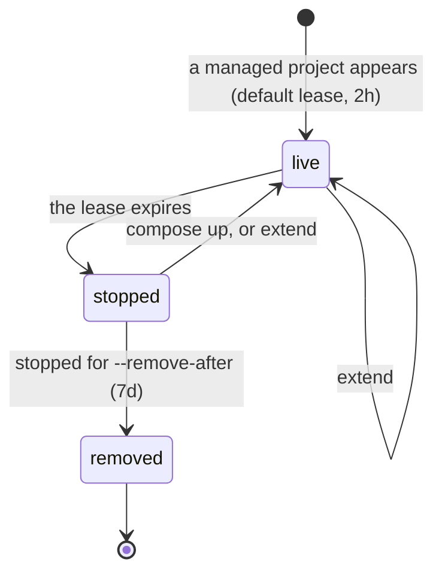
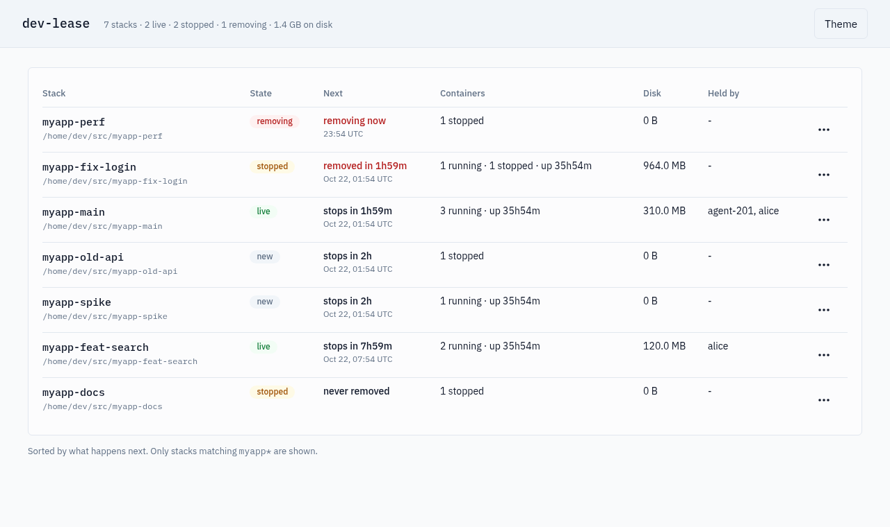
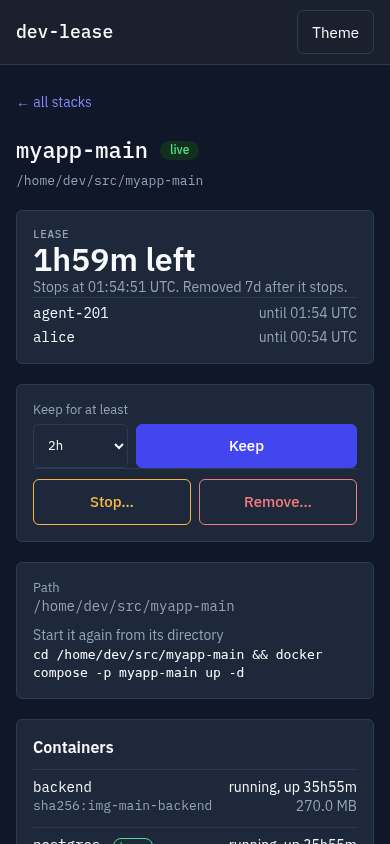

# dev-lease

dev-lease stops and then removes the Docker Compose stacks nobody uses any
more. It is one small container on a Linux machine with Docker. Every stack
whose Compose project name matches your patterns gets a lease, and whoever
uses the stack extends it: a person, a script, a CI job, an AI agent's hook.

- When the lease expires, the stack is stopped: its RAM and CPU are free
  again, and its data stays.
- When it stays stopped for 7 days (the delay is yours to set), it is
  removed: its containers, networks, volumes and the images Compose built
  for it.
- Labels in your compose file keep a service or a volume, or change the
  delay for one stack (`0`: stopped, never removed by a sweep).
- You see and extend the stacks on the command line; the
  [web dashboard](#dashboard) can also stop and remove them, and AI agents
  see, stop and remove them over [MCP](#mcp-for-ai-agents).
- It never starts, builds or pulls anything, and never touches a project
  outside your patterns.

Built for machines that run many git worktrees and AI coding agents at
once. For AI agents, [Summary for AI agents](#summary-for-ai-agents) has
the facts in short form.

## Contents

- [Why](#why)
- [How it works](#how-it-works)
  - [When a stopped stack is removed](#when-a-stopped-stack-is-removed)
  - [What belongs to a stack](#what-belongs-to-a-stack)
  - [Labels](#labels)
  - [Check what dev-lease sees](#check-what-dev-lease-sees)
- [Quick start](#quick-start)
- [Dashboard](#dashboard)
- [MCP for AI agents](#mcp-for-ai-agents)
- [With git worktrees](#with-git-worktrees)
- [With automation and AI agents](#with-automation-and-ai-agents)
- [Commands](#commands)
- [Safety](#safety)
- [Images and platforms](#images-and-platforms)
- [Summary for AI agents](#summary-for-ai-agents)
- [Development](#development)

## Why

I work in many git worktrees at the same time. Each worktree runs its own
Compose stack under its own project name (`myapp-feat-login`,
`myapp-fix-cache`, ...), so one repository can have a dozen stacks on the
machine. AI agents and test workers start more of them for test runs and
reviews, and leave them running when they finish, crash or time out. After
a day the host is out of RAM and CPU, the disk is full of volumes and
images, and nobody remembers which stack still matters.

dev-lease turns "it is running" into "someone holds a lease on it". Whoever
uses a stack extends its lease: a person, a script, a CI job, an agent hook.
When nobody does, the stack is stopped, which frees RAM and CPU at once and
keeps the data. If nobody comes back to it, it is removed, which frees the
disk.

## How it works



| State | What dev-lease does | How it leaves the state |
| --- | --- | --- |
| live | Nothing. The lease lasts until the latest holder's expiry. | `extend` prolongs it; at expiry the stack is stopped. |
| stopped | Stops every container of the project except kept ones (`--stop-timeout`). Deletes nothing. | `docker compose up -d` brings it back with its data, and it gets the default lease at the next sweep; `extend` renews the lease (you start the stack). |
| removed | Removes the containers, networks, volumes (with their data) and the project's own images. Then the lease is deleted. | If the project shows up again, it starts as a new one. |

dev-lease is one small container, `dev-lease serve`, that sweeps every
minute. It runs all the time by default and comes back with Docker after a
reboot. It never starts, builds or pulls anything. You talk to it with
`docker exec`, look at it in the [dashboard](#dashboard), and let agents use
it over [MCP](#mcp-for-ai-agents).

`--remove-after 0` turns the sweep's removals off: expired stacks are only
stopped. (You can still remove one yourself from the dashboard, behind its
typed name; MCP refuses.)

### When a stopped stack is removed

A stopped stack's delay is recorded when it stops and counted from the
stop: the stack's own `dev-lease.remove-after` label, else serve's
`--remove-after` at that moment. A label's delay stays as it
is. A delay taken from serve's setting is never cut by a later, shorter
setting, and a longer one lengthens it while it is in force.
`--remove-after 0` pauses every sweep removal while it is set; when it is lifted,
the delays apply again under the new setting, so stacks already past theirs
go at the next sweep. A stack without a label that stops while serve runs
with `0` records `0` and stays until someone starts or extends it.

### What belongs to a stack

Only projects whose Compose project name matches your `--projects`
patterns are touched; everything else on the machine, dev-lease's own
project included, is never stopped or removed. A project's objects are
found by the Compose label
`com.docker.compose.project`. Its own images are the images Compose built
for it: with the project label, the ones its containers ran from and the
ones tagged `<project>-<service>:<tag>`; without any label (Compose v2 builds
them that way), the ones named exactly `<project>-<service>` for one of the
stack's own services. dev-lease records a stack's services at every sweep, so
this still works after `docker compose down`. Pulled images such as
`postgres:16-alpine` never match and are never removed, and Docker itself
refuses to delete an image another container uses. (Compose can give two
stacks the same image name: service `feat-web` of `myapp` and service `web`
of `myapp-feat` both build `myapp-feat-web`.) An object Docker refuses or fails to remove is logged and left in
place; if that leaves the stack present, it is treated as a new one: it gets
the default lease, and is stopped and later removed again.

### Labels

Labels in your own compose file keep things, or change the policy for one
stack:

```yaml
services:
  db:
    labels:
      dev-lease.keep: "true"          # never stopped or removed
  web:
    labels:
      dev-lease.remove-after: "0"     # this stack is only stopped, never removed
volumes:
  pgdata:
    labels:
      dev-lease.keep: "true"          # never removed
```

A kept service does not keep the rest of its stack alive; the networks,
volumes and images it uses are left in place. `dev-lease.remove-after`
takes a duration of at least an hour (`48h`, `30d`) or `0`; when services
disagree, `0` wins, else the longest value. A value dev-lease cannot read,
or one under an hour, counts as `0`, and is logged.

Labels are read from containers and volumes as Docker created them. Docker
cannot change the labels of an existing volume, so adding `dev-lease.keep` to
a volume means recreating it. A removal delay is read from the containers at
every sweep and recorded in the lease, so it still applies after a
`docker compose down`; a stack taken down before any sweep has seen its
containers gets serve's setting. For data that must survive whatever
happens, put `dev-lease.keep` on the volume. Docker also copies an image's
labels to its containers, so an image you build `FROM` can carry these
labels too. `dev-lease.keep` works on services and volumes, not on
networks.

### Check what dev-lease sees

`dl status` ([Quick start](#quick-start), step 3) lists, per stack, the containers,
networks, volumes and images it counts as the stack's, and the dashboard's
stack page shows which images go with the stack and which stay. To read the
labels yourself:

```bash
docker inspect myapp-feat-login-web-1 --format '{{json .Config.Labels}}'      # dev-lease.keep, dev-lease.remove-after on a service
docker volume inspect myapp-feat-login_pgdata --format '{{json .Labels}}'      # dev-lease.keep on a volume
docker image inspect myapp-feat-login-web --format '{{json .Config.Labels}}'   # does Compose label your built images?
docker compose version
```

Compose v5 labels the images it builds with `com.docker.compose.project` and
`com.docker.compose.service`; Compose v2 leaves them without labels (`null`).
dev-lease removes a stack's built images either way.

## Quick start

You need Docker Engine with Compose v2 or later on Linux.

1. Copy [examples/basic/compose.yml](examples/basic/compose.yml) and its
   [`.env.example`](examples/basic/.env.example) into one directory, as
   `compose.yml` and `.env`. Set the projects dev-lease may manage in `.env`:
   `DEV_LEASE_PROJECTS=myapp,myapp-*`. Compose reads `.env` from the compose
   file's directory, so every command against the file (`up`, `down`,
   `logs`) sees the same values (a variable your shell exports wins over
   `.env`). (On a laptop that should not keep Docker
   busy, use [examples/on-demand](examples/on-demand) instead: serve exits
   when nothing is left to watch.)
2. Start serve:

   ```bash
   docker compose -p dev-lease -f compose.yml up -d --wait
   ```

   Keep `-p dev-lease`: it gives serve one fixed project name that every
   command finds, and that name must not match your patterns (serve refuses
   to start when its own project matches one, and while another dev-lease
   server runs). After you change `.env`, run the same command with
   `--force-recreate` once; the example scripts start serve with
   `--no-recreate`, so they never replace it with their own environment.

   When serve first starts, every stack that matches the patterns gets the
   default lease and is stopped when that expires, unless someone extends
   it: start with narrow patterns.
3. Talk to it with `docker exec`. A shell function saves typing:

   ```bash
   dl() { docker exec "$(docker ps -qf label=dev-lease.role=server)" dev-lease "$@"; }

   dl extend myapp-feat-login 4h --holder "$USER"
   dl list
   dl status
   ```

   `dl list` prints one line per stack, for example
   `myapp-feat-login: live, 3h59m left (until 2026-10-21T14:05:00Z; holders: alice)`
   or `myapp-fix-cache: stopped 3h ago; removed in 6d20h (at 2026-10-28T06:02:00Z)`.
   `dl status` adds each stack's containers, networks, volumes and images.

   On PowerShell: `docker exec (docker ps -qf label=dev-lease.role=server) dev-lease list`.

To stop dev-lease, run `docker compose -p dev-lease -f compose.yml down` in the
same directory. Its state volume stays; add `-v` to forget every lease. Your
stacks are not touched either way.

## Dashboard



The examples turn on a small web page at <http://127.0.0.1:8410>. The main
page lists every stack dev-lease manages, and only those: where it lives,
what runs, the disk its volumes use, who holds the lease and what happens
next, soonest first. `⋯` opens a stack: its lease and holders, the command
that starts it again, its containers, volumes and images, and the last lines
of a container's log. Every action lives there: keep it for at least 2h, 8h,
1d or 7d (a lease is never shortened), release the dashboard's claim, stop
it, or remove it. Stop asks for confirmation and says exactly which
containers stop and which kept ones keep running; remove lists exactly what
is deleted and what stays, and needs the stack's name typed. A stack marked
never remove can be removed here only behind that typed name and a warning.



It works on a phone too. To reach it over Tailscale (or another VPN), set
three values in serve's `.env` and run serve's `up` once with
`--force-recreate`:

```bash
DEV_LEASE_DASHBOARD_BIND=100.101.102.103            # this machine's Tailscale address
DEV_LEASE_DASHBOARD_HOSTS=devbox,devbox.tail1234.ts.net,100.101.102.103
DEV_LEASE_DASHBOARD_TOKEN=<openssl rand -hex 32>    # the page asks for it, again after serve restarts
```

The page answers only for the host names in `DEV_LEASE_DASHBOARD_HOSTS`
(default `localhost`, `127.0.0.1`, `[::1]`). Every action needs a token from
the page itself and a matching `Origin`, so another site open in your
browser cannot act through it. Anyone who can reach the port and passes the
token can stop and remove stacks, so never bind it to `0.0.0.0` on a machine
with a public interface, and set the token whenever the bind is not
`127.0.0.1`. On `127.0.0.1` without a token, every user and process on this
machine can do the same, Docker access or not; set the token on a shared
machine. The page loads nothing from outside and needs no JavaScript to
read; with JavaScript it refreshes every 15 seconds.

<br clear="right">

## MCP for AI agents

`dev-lease mcp` is an MCP server over stdio inside the serve container, so
an agent can see the stacks and stop or remove one:

```bash
claude mcp add dev-lease -- sh -c 'docker exec -i "$(docker ps -qf label=dev-lease.role=server)" dev-lease mcp'
```

| Tool | What it does |
| --- | --- |
| `list_stacks` | Every managed stack with its state, what happens next, containers, disk and holders. |
| `stack_details` | One stack: containers, volumes, networks, the images that go and stay, the start command, optionally the last log lines. |
| `stop_stack` | Stops the stack now and ends every claim; nothing is deleted. |
| `remove_stack` | Stops and removes the stack now; `confirm` must repeat the name. A stack marked never remove is always refused. |

Agents see only managed stacks. Stop and remove run inside serve, serialised
with its sweeps and under the same rules as a sweep. More, with a config for
other MCP clients: [examples/agents/mcp.md](examples/agents/mcp.md).

## With git worktrees

Give every worktree its own Compose project name, `<repo>-<worktree>`, and
let one pattern manage them all (`DEV_LEASE_PROJECTS=myapp-*` in `.env`).

[examples/worktrees](examples/worktrees) has `up.sh` (and a `just up`
recipe): it derives the project name from git, starts the worktree's stack
with `docker compose -p <name>` and extends its lease (`./up.sh 4h`). Every
later compose command in that worktree needs the same `-p` (or
`COMPOSE_PROJECT_NAME`). Stacks of branches you left stop after their lease
and free RAM at once; their volumes go a week later unless you come back.

## With automation and AI agents

The rule for every caller is the same: extend when you start or use a
stack, with a TTL that covers the job, and never extend a stack you are not
using. Each extend records a holder, so `dl list` shows who keeps a stack
alive: pass `--holder <name>` (through `docker exec` the default is
`local`).

- **Claude Code.** [examples/agents](examples/agents): copy
  `lease-extend.sh` to `.claude/hooks/` and merge
  `claude-code-settings.json` into `.claude/settings.json`. Every session
  then extends the worktree's lease for 2 hours.
- **Any agent.** Paste [AGENTS-snippet.md](examples/agents/AGENTS-snippet.md)
  into the repository's `AGENTS.md` so every agent knows when to extend and
  how to bring a stopped stack back.
- **CI and test loops.** Run [examples/ci/extend.sh](examples/ci/extend.sh)
  before a test run on a self-hosted runner or in a local loop.
- **Long jobs.** Extend with a TTL that covers the whole job (up to 7 days),
  or extend again from the job's loop. A shorter extend never cuts a lease.
- **Done early.** `dl release <project> --holder <name>` ends one claim;
  `--all` ends every claim and the next sweep stops the stack.

`lease-extend.sh` and `ci/extend.sh` never fail an agent or a pipeline:
when Docker or serve is not there, they print a short message and exit 0
(`up.sh` reports an error when your stack cannot be started). Set
`DEV_LEASE_COMPOSE` to the path of your dev-lease compose file, with its
`.env` next to it, and they start serve themselves, without ever replacing
a serve that exists.

## Commands

| Command | What it does |
| --- | --- |
| `extend <project> <ttl> [--holder <name>]` | Renews that holder's claim; never shortens it. `ttl` from 1m to 7d. On a stopped stack the lease is live again; start the stack yourself. |
| `release <project> (--holder <name> \| --all)` | Ends one claim, or every claim. |
| `list` | Every lease with its time left, its live holders, or when it stopped and when it is removed. |
| `status` | For every managed stack: its containers, networks, volumes, images and lease; one "not managed" line for every other project. |
| `serve --projects <patterns> [flags]` | The watcher (below). |
| `mcp` | The MCP server for agents, over stdin and stdout (run it with `docker exec -i`). |
| `-version` | The build version. |

Exit codes: 0 ok; 1 a usage error, a bad TTL, an unreadable state file or a
failed Docker listing; 2 not a managed project; 3 the stack is being stopped
or removed right now (retry in a moment).

Durations are Go durations (`90m`, `2h`) or whole days (`7d`).

| serve flag | Default | Meaning |
| --- | --- | --- |
| `--projects` (`DEV_LEASE_PROJECTS`) | required | Comma-separated glob patterns over Compose project names. |
| `--default-ttl` | `2h` | The lease a new managed stack gets. |
| `--remove-after` (`DEV_LEASE_REMOVE_AFTER`) | `168h` | How long a stopped stack is kept before removal, counted from the stop; `0` pauses every sweep removal. A later, shorter value never cuts a delay recorded at a stop. |
| `--interval` | `1m` | How often serve sweeps. |
| `--stop-timeout` | `10s` | Stop timeout per container. |
| `--exit-when-idle` | `false` | Exit when nothing is left to watch (the on-demand example sets it). |
| `--dashboard` (`DEV_LEASE_DASHBOARD`) | off | Listen address of the dashboard inside the container (the examples use `:8410`; where it is reachable is set by the Compose port mapping). |
| `--dashboard-hosts` (`DEV_LEASE_DASHBOARD_HOSTS`) | `localhost,127.0.0.1,[::1]` | Host names the dashboard answers for. |
| `DEV_LEASE_DASHBOARD_TOKEN` | none | Environment only: the token the dashboard asks for. Never logged. |
| `--state` (`DEV_LEASE_STATE`) | `/data/leases.json` | The state file, on the state volume. |
| `--socket` | `/var/run/docker.sock` | The Docker socket. |

Full reference (the state file, a sweep step by step, the log format):
[docs/reference.md](docs/reference.md).

## Safety

**Mounting the Docker socket gives a container root-equivalent power over
the host.** dev-lease limits itself, but treat the image like any tool you
give root.

- Before the first Docker call serve drops to uid 65532, keeping only the
  group that owns the socket. Its Engine API client is an allowlist of exact
  method and path pairs.
- serve refuses to start when its own project matches a managed pattern,
  when its container lacks the label `dev-lease.role=server`, when another
  serve holds the lock on the same state file, or while another dev-lease
  server runs on the same Docker.
- A state file that cannot be parsed, or carries an unknown version, stops
  serve; it is never overwritten. Updates are atomic and locked, so serve
  and the client commands never see a half-written file.
- Ownership is the Compose label and nothing else. Anything carrying a
  managed project's label counts as that project's, a volume shared into it
  by `name:` included, and is removed with it, except services and volumes
  labelled `dev-lease.keep` and the networks, volumes and images a kept
  service uses. Images follow the narrower rule above.
- Removal deletes named volumes and the data in them. Keep anything you
  need elsewhere, label it `dev-lease.keep`, or run with `--remove-after 0`.
- The dashboard is off unless `--dashboard` is set, and reachable only where
  the Compose port mapping puts it (`127.0.0.1` in the examples). It
  answers only allowed host names, and every action needs the page's own
  token and a same-origin request. MCP never removes a stack marked never
  remove. Both act only through serve, under the same rules as a sweep.

## Images and platforms

The image is `ghcr.io/andrius/dev-lease`, for linux/amd64 and linux/arm64,
with a build provenance attestation:

```bash
gh attestation verify oci://ghcr.io/andrius/dev-lease:v0.1.0 --owner andrius
```

CI runs on Linux. Docker Desktop on macOS and Windows is not tested yet (the
[release checklist](docs/release-checklist.md) has the manual steps); its
Enhanced Container Isolation mode blocks socket mounts and is not supported.

## Summary for AI agents

The facts an AI agent needs on a machine where dev-lease runs. Commands
below that start with `dev-lease` run inside the serve container: prefix
each with `docker exec "$(docker ps -qf label=dev-lease.role=server)"`. If
that finds no container, serve is not running (the on-demand example exits
when idle); the example scripts start it when `DEV_LEASE_COMPOSE` is set.
The full behaviour is in [docs/reference.md](docs/reference.md).

- **What is managed.** Compose projects whose name matches serve's
  `--projects` glob patterns; `dev-lease extend` exits 2 for any other
  name. A project's objects are the ones carrying its
  `com.docker.compose.project` label. Nothing else on the daemon is touched.
- **What happens to a managed stack.** It gets a lease (2h by default). At
  expiry every container is stopped, except services labelled
  `dev-lease.keep`; no data is deleted. After the removal delay (7 days by
  default, counted from the stop) its containers, networks, volumes with
  their data, and the images Compose built for it are removed. A removal
  cannot be undone.
- **Before you use a stack,** extend its lease with a TTL that covers the
  job (1m to 7d): `dev-lease extend <project> <ttl> --holder <your-name>`.
  A shorter extend never cuts a lease. Do not extend a stack you are not
  using.
- **When you are done:** `dev-lease release <project> --holder <your-name>`.
- **To see the state:** `dev-lease list` prints one line per lease (live
  with its time left and holders, expired, or stopped and when it is
  removed); `dev-lease status` lists every managed stack with its
  containers, networks, volumes and images.
- **A stopped stack is not lost:** `docker compose -p <project> up -d`, run
  on the host in the stack's own directory, brings it back with its data
  (`stack_details` and the dashboard print the exact command as
  `start_command`). A removed stack is gone, volumes included.
- **To protect data,** use the [labels](#labels): `dev-lease.keep: "true"`
  on a volume or a service, or `dev-lease.remove-after: "0"` on a service
  (the stack is only stopped, never removed by a sweep). A label on an
  existing volume needs the volume recreated.
- **Over MCP** (`dev-lease mcp`): `list_stacks` and `stack_details` only
  read. `stop_stack` stops the stack now and ends every holder's claim, so
  do not stop a stack whose `holders` in `list_stacks` is not empty.
  `remove_stack` deletes data and needs `confirm` equal to the stack name;
  a stack marked never remove is always refused. Ask the person before you
  remove a stack.
- **Exit codes:** 0 ok; 1 a usage error, a bad TTL, an unreadable state
  file or a failed Docker listing; 2 not a managed project; 3 the stack is
  being stopped or removed right now, retry in a moment.
- **To tell agents in your own repository,** paste
  [AGENTS-snippet.md](examples/agents/AGENTS-snippet.md) into its
  `AGENTS.md`.

## Development

```bash
go vet ./...
go test -race ./...
go test -tags integration ./integration/...   # needs Docker; creates and removes devlease-it-* and devlease-keep-* projects
```

The browser tests (Playwright, in [e2e/](e2e)) run in CI against a real
serve with two demo stacks; [e2e/README.md](e2e/README.md) shows how to run
them locally.

Unit tests run against a fake Docker daemon with an injected clock; the
integration test runs the whole lifecycle (live, stopped, removed, with a
kept service and a kept volume) against a real daemon. CI also checks every
example: `docker compose config` for the compose files, `bash -n` and
shellcheck for the scripts, `jq` for the JSON, and a smoke test that starts
serve from the basic example and extends a lease with the agent script.

More: [docs/design.md](docs/design.md) (the decisions and why),
[docs/reference.md](docs/reference.md), [examples/](examples),
[docs/release-checklist.md](docs/release-checklist.md).

MIT licensed.
